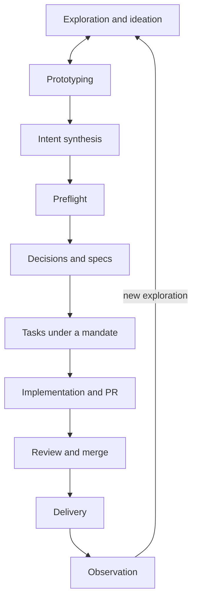

<div align="center">

<h1>SMard Agent Flow</h1>

<p><b><i>From Discomfort to Production</i></b></p>

<p>
A human-led software workflow for the age of autonomous agents.<br>
It connects creative exploration to the tool that runs your tasks, so that
development, even when it runs autonomously, still reflects human choices.
</p>

<p>
<a href="LICENSE"></a>


</p>

<p>
<a href="MISSION.md">Mission</a> ·
<a href="#why-this-exists">Why</a> ·
<a href="#what-it-actually-does">What it does</a> ·
<a href="#the-cycle">The cycle</a> ·
<a href="#honest-about-state">State</a> ·
<a href="#get-started">Get started</a> ·
<a href="#method-docs-canonical-sources">Docs</a> ·
<a href="#attribution-and-license">License</a> ·
<a href="#how-to-cite">Cite</a> ·
<a href="#author">Author</a>
</p>

</div>

---

SMard Agent Flow accompanies a person from a discomfort that still has no
language (something wrong in the world, a curiosity, a half-seen opportunity)
all the way to the observed effects of real software in use, without ever
forcing that discomfort into a form before it is ready.

## At a glance

| | |
| --- | --- |
| **The problem** | Spec kits and agentic flows assume the idea is already finished, and leave the human to brief, supervise, or approve. |
| **What you get** | A cycle from exploration to observation that you can enter anywhere, documents elaborated in view, and three distinctions that never collapse. |
| **How it ships** | A plugin for coding-agent harnesses: twelve namespaced skills and two read-only agents, plus the short entry command `/smard-agent-flow`. Created in Claude Code; today it operates in harnesses of twelve vendors. |
| **Who it is for** | People who build software with autonomous coding agents and want to stay at the origin of the choice. |
| **What it does not do** | Replace your executor, install hooks or MCP servers, activate automations, or change any repository's review, merge, or deploy policy. |

## Why this exists

Every spec-kit and agentic flow quietly assumes the idea is already finished.
They hand the human one of three roles: supply the briefing, supervise the
commands, approve the merge. Each is a cage. Each starts *after* the hardest and
most human part is already over.

But software begins before the requirement — in brainstorming, exploration,
ideation, prototyping. That creative pre-flight is exactly what the kits skip.
And here is the twist that matters most now: when a machine can write the code,
the code stops being scarce. The scarce thing becomes the *choice*. The
pre-flight is the one stage that guarantees development, even when it runs
autonomously, still reflects human will, ideas, and choices.

So the developer changes what they are. They stop being a programmer and become
a **systems engineer** — the holder of intent, boundaries, and consequences, who
delegates the typing. The origin of the thing, not an input to it. The method's
word for that human is `HOMUS-FIATIVUM`: the source of the creative *let it be*.

## What it actually does

SMard Agent Flow connects creative work to spec-driven and task-driven execution
without replacing your executor. Point it at Spec Kit, OpenSpec, or whatever
runs your tasks; it feeds that executor intent a human actually ratified, and
brings the results back into the product's cycle.

### The cycle

It gives you a cycle you can enter anywhere:



> exploration & ideation ↔ prototyping → intent synthesis → preflight → decisions
> & specs → tasks under a mandate → implementation & PR → review & merge →
> delivery → observation → new exploration

No ceremony is mandatory. A mature initiative can start further along. Pausing,
incubating, or deciding not to build are legitimate endings. A repository, a
product name, a branch — none of them are required to think.

### Three distinctions that never collapse

What makes it trustworthy is what it refuses to blur. Three distinctions are
load-bearing and never collapse:

| Distinction | What it protects |
| --- | --- |
| **draft ≠ presented ≠ ratified** | A draft never authorizes its own execution. |
| **merge ≠ approval ≠ deploy ≠ observed benefit** | Green CI is not success in production. |
| **evidence ≠ inference ≠ hypothesis ≠ observation** | A simulation is never mistaken for a measured fact. |

### Documents born in view

Every document is born in view: the agent names its purpose in chat, shows its
substantive content, and keeps gaps and disagreements visible. Silence, a file's
existence, and a merge never ratify the agent's interpretation. Autonomy is real
but bounded — the agent runs inside a mandate and stops when it would exceed it.

## Honest about state

The method is in elaboration. Some pieces are **proposed, not built**, and this
README says so plainly: the precompact hook and automatic session recovery are
not implemented, and the Spec Kit integration is a future investigation that
installs or modifies nothing yet. The documents here do not activate automations
or change any repository's review, merge, or deploy policy.

| Piece | State | Source |
| --- | --- | --- |
| The method documents | In elaboration: design authorized for elaboration; operational details proposed where no explicit decision exists | [METHODOLOGY.md](METHODOLOGY.md) |
| Plugin and marketplace | Packaged: twelve skills and two read-only agents; no hooks, no MCP servers | [plugin/README.md](plugin/README.md) |
| Harnesses | In operation in harnesses of twelve vendors (statement of the operator, 2026-11-14). The installers in this repository set it up for Claude Code; the adapter folders for other harnesses here are reserved | [plugin/README.md](plugin/README.md) |
| Installers (Windows setup, ZIP, Node.js) | First release: checked on Linux and under Wine; the run on Windows is the operator's validation. winget manifest prepared, not submitted | [plugin/README.md](plugin/README.md) |
| Precompact hook and automatic session recovery | Not implemented | [specs.md](specs.md), [SESSION-MEMORY.md](docs/production-workflow/SESSION-MEMORY.md) |
| Spec Kit integration | Future investigation; installs or modifies nothing yet | [specs.md](specs.md) |
| GitHub Actions checks named in the workflow | Interface design only; no such jobs exist in this repository | [specs.md](specs.md) |
| Review, merge, and deploy policy | Unchanged by the method: the design activates no automation and configures no branch protection, environments, or merge queue | [WORKFLOW.md](docs/production-workflow/WORKFLOW.md), [RULES.md](RULES.md) |

## Get started

### Install

SMard Agent Flow is not tied to one harness. The installers of this release
set it up for Claude Code, the harness in which it was created, so Claude Code
must already be installed. They are for Windows.

**The short way.** Download `SMardAgentFlow-Setup-<version>.exe` from the
[latest release](https://github.com/mardemsean/smard-agent-flow-git/releases/latest)
and double-click it. Then open a new Claude Code session and type
`/smard-agent-flow`. The installer asks for no administrator password and only
copies files into your Claude Code settings folder.

| Other ways | How |
| --- | --- |
| Inside Claude Code | Add the marketplace and install the plugin (the two commands below). |
| Node.js | `npx github:mardemsean/smard-agent-flow-git` |
| ZIP | Download `smard-agent-flow-<version>-windows.zip` from the release, extract it, double-click `Install.cmd`. |
| winget | Manifest prepared as `SMardLabs.SMardAgentFlow`; not yet in the winget community repository. |

```text
/plugin marketplace add mardemsean/smard-agent-flow-git
/plugin install smard-agent-flow@smard-agent-flow-marketplace
```

While the repository is private, the downloads and these commands use your
GitHub access. Every route, how to remove the plugin, the ROOT rule the skills
follow, and the verification and release steps are in
[plugin/README.md](plugin/README.md).

### Start here

| Document | What you find there |
| --- | --- |
| [MISSION.md](MISSION.md) | Why this exists: what we found when we audited our own repositories, and who answers for it. |
| [plugin/README.md](plugin/README.md) | The plugin and its marketplace: install routes, the ROOT rule of the skills, verification and release steps. |
| [explore.md](explore.md) | The EXPLORE phase, stage by stage, and the story of the discomfort and the systems-engineer thesis, in the method's own voice. |
| [specs.md](specs.md) | The method's own specification: invariants, states, and the document chain. |
| [adrZERO.md](adrZERO.md) | ADR-0000, the foundational decision to wrap an executor rather than replace it. |

## Method docs (canonical sources)

| Document | What it holds |
| --- | --- |
| [METHODOLOGY.md](METHODOLOGY.md) | Intent and the articulation of the cycle. |
| [RULES.md](RULES.md) | The human-agent working rules. |
| [WORKFLOW.md](docs/production-workflow/WORKFLOW.md) | The decision tree, states, passage criteria, and GitHub integration contract. |

---

If you build with autonomous agents and you have felt the quiet wrongness of
being treated as a briefing machine for your own ideas — this is the flow that
puts you back at the origin. Try an exploration. Bring a discomfort. Keep the
choice.

---

## Attribution and license

> [!NOTE]
> **Disclaimer.** The documentary part of this method that covers the workflow
> for Git and CI/CD was heavily inspired by GitHub's Spec-Driven Development
> workflow documentation, published with
> [GitHub Spec Kit](https://github.com/github/spec-kit)
> ([spec-driven.md](https://github.com/github/spec-kit/blob/main/spec-driven.md),
> [documentation site](https://github.github.com/spec-kit/)).

SMard Agent Flow is an independent work of SMard Labs. It is not affiliated
with, endorsed by, or sponsored by GitHub; "GitHub" and "Spec Kit" are named
here only to credit the source. This attribution is about the documents: it does
not mean that Spec Kit is installed or integrated (see
[*Honest about state*](#honest-about-state)).

Spec Kit was not the only reading. The documentary review behind the method
covered six public repositories: Spec Kit, OpenSpec, BMAD-METHOD, the GitLab
handbook, Google's engineering practices documentation, and a guide to
test-driven development. [REFERENCIAS.md](REFERENCIAS.md) lists them as ABNT
references, with the commit of each snapshot and the evidence of the review.

Because of that origin, this repository inherits the license declared by the
source repository, the MIT License, by decision of the rights holder on
2026-11-13. [LICENSE](LICENSE) carries the license text and keeps GitHub's
copyright notice next to ours.

## How to cite

GitHub shows a **Cite this repository** button on the repository page, fed by
the file `CITATION.cff`; the button gives APA and BibTeX. The other formats are
written out here.

**ABNT (NBR 6023)**

> MARDEM, Sean. **SMard Agent Flow**: from discomfort to production. Versão
> 0.6.2. Natal: SMard Labs, 2026. Disponível em:
> https://github.com/mardemsean/smard-agent-flow-git. Acesso em: 14 nov. 2026.

Replace the date after "Acesso em:" with the day you consulted the repository.
In the text, under NBR 10520: (Mardem, 2026) or Mardem (2026).

| Style | Reference |
| --- | --- |
| APA 7 | Mardem, S. (2026). *SMard Agent Flow: From discomfort to production* (Version 0.6.2) [Computer software]. SMard Labs. https://github.com/mardemsean/smard-agent-flow-git |
| Chicago (author-date) | Mardem, Sean. 2026. *SMard Agent Flow: From Discomfort to Production*. V. 0.6.2. SMard Labs. https://github.com/mardemsean/smard-agent-flow-git. |
| IEEE | S. Mardem, *SMard Agent Flow: From Discomfort to Production*, version 0.6.2. SMard Labs, 2026. [Online]. Available: https://github.com/mardemsean/smard-agent-flow-git |
| MLA 9 | Mardem, Sean. *SMard Agent Flow: From Discomfort to Production*. Version 0.6.2, SMard Labs, 2026, github.com/mardemsean/smard-agent-flow-git. |

```bibtex
@software{mardem_smard_agent_flow_2026,
  author    = {Mardem, Sean},
  title     = {{SMard Agent Flow}: from discomfort to production},
  version   = {0.6.2},
  year      = {2026},
  month     = nov,
  publisher = {SMard Labs},
  address   = {Natal, Brazil},
  url       = {https://github.com/mardemsean/smard-agent-flow-git},
  license   = {MIT}
}
```

## Author

<p align="center">
<a href="https://mardemsean.org"></a>
</p>

<p align="center">
<a href="https://mardemsean.org">mardemsean.org</a> ·
<a href="mailto:smardlabs@mardemsean.org">smardlabs@mardemsean.org</a> ·
<a href="https://github.com/mardemsean">GitHub</a> ·
<a href="https://www.linkedin.com/in/sean-mardem-2643b9204/">LinkedIn</a> ·
<a href="https://orcid.org/0009-0004-5677-2402">ORCID</a> ·
<a href="https://scholar.google.com/citations?user=ZdGNDUsAAAAJ">Google Scholar</a> ·
<a href="https://huggingface.co/sean-mardem">Hugging Face</a> ·
<a href="https://www.youtube.com/@sean.mardem">YouTube</a>
</p>
