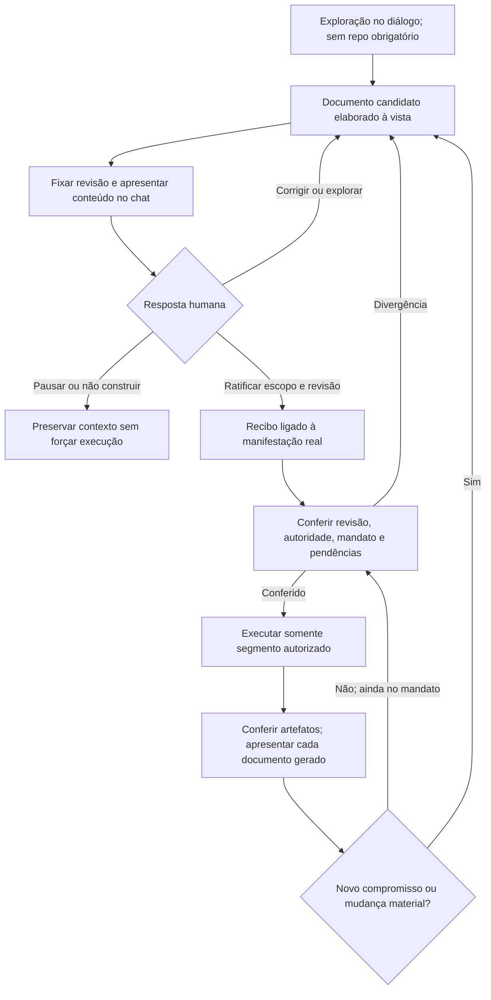

# Adaptação ao Spec Kit — passagem entre conversa e execução

**Repositório constituído por decisão humana:** `mardemsean/smard-agent-flow-git` (originalmente citado no handoff anterior como `smard-agent-flow-kit`).
**Estado:** preflight corrigido e proposta de integração, não implementação.
**Origem:** solicitação humana de 2026-10-16 para corrigir a passagem de ponta a
ponta, após leitura do handoff de 10:37, mapa PONTE e parecer adversarial.
**Elaboração no chat:** proposta de correção explicitada antes desta redação;
detalhes abaixo são recomendações do agente, não escolhas humanas presumidas.

## 1. Escopo e procedência

Este documento complementa a [baseline](BASELINE-METODO.md) e corrige o mapa
externo `PONTE-SPECS-TAREFAS--smard-agent-flow-kit.md`, sem sobrescrevê-lo nem
importar memórias privadas para o repositório. Em qualquer divergência entre o
mapa externo anterior e este documento, prevalece este `ADAPTACAO-SPECKIT.md`.

O handoff registra decisões tomadas em outra sessão: Claude Code como integração;
configuração antes de fork; possibilidade de um tipo de passo Python próprio;
reavaliação de fork após três pilotos pequenos satisfatórios; `agent-context`
para seções de contexto; memória via hook Claude fora do executor.
São decisões **relatadas pelo predecessor**, cuja conversa original não foi
consultada. Este documento não as transforma em autorização de instalação.

A opção de gate nativo foi registrada naquele mapa, mas depende de um encaixe
que o próprio handoff deixou sem resolver. Preservar a intenção de ratificação
humana; não tratar o mecanismo como tecnicamente resolvido.

### Evidência consultada e limite

Foram lidos arquivos do snapshot local atribuído a
`96774bc52fd7dccc7185791e1cac7572b9e09dea`, documentação e implementação de gate
e despacho de comandos. Não foi conferido novamente o hash do pacote original,
nem demonstrado que o conteúdo extraído corresponde a esse commit: o diretório
consultado não contém metadados Git utilizáveis. Antes de qualquer piloto
executável, é obrigatório verificar esse hash contra um checkout Git íntegro e
fixar a versão exata da árvore (`workflows/step/` vs `workflows/steps/`). As
constatações abaixo dizem respeito aos arquivos locais efetivamente lidos, não
à versão atual na internet.

Os arquivos de memória citados na captura foram localizados. Seus relatos e
preferências orientam a retomada, mas não substituem fonte técnica nem concedem
novas permissões. Não redefinem as funções dos dois registros persistentes.

## 2. Correções factuais com trechos da fonte

Os localizadores abaixo são relativos à raiz do snapshot do Spec Kit.
Trechos são evidência de contrato/implementação lida; testes não foram executados.

| Tema | Fonte e trecho literal | Consequência para o desenho |
| --- | --- | --- |
| Skills no Claude | `docs/reference/integrations.md:13`: “Skills-based integration; installs skills in `.claude/skills`.” | Skill avulsa não comprova execução de um workflow |
| Workflow e integração | `design/workflow-step.md:3–6`: “distinct from an agent integration: integrations dispatch work to an agent; steps validate and execute workflow behavior.” | Separar interlocução, despacho e controle de passagem |
| Gate não se limita a um sim/não sem documento | `src/specify_cli/workflows/step/gate/__init__.py`, `GateStep.execute`: “`show_file` contents are folded into the displayed message” | Pode exibir arquivo no terminal interativo; o parecer anterior omitiu essa capacidade |
| Sem terminal interativo | Mesmo arquivo, antes de retornar `PAUSED`: “Non-interactive: pause for later resume (the file is not read here)” | Pausa do engine não prova apresentação do documento no chat |
| Limite de apresentação | `GateStep.MAX_SHOW_FILE_LINES = 200`; `_read_show_file` descreve aviso quando arquivo não pode ser lido | Arquivos com mais de 200 linhas são truncados no terminal interativo e nem sequer são lidos fora de TTY; `show_file` nunca substitui apresentação no chat (R2) |
| Veredicto por input | `docs/reference/workflows.md:1177–1182`: “Gate auto-decides”; “A non-empty `default` is consumed as a verdict on the first run” | Nunca preencher aprovação antecipada nem confundir input com manifestação humana autenticada |
| Validação prévia e `on_reject` | `src/specify_cli/workflows/step/gate/__init__.py:56–64, 85–94`: o engine não autovalida antes de `execute`; `on_reject: retry` limpa o input vinculado (`:210`) e exige `""` no enum (`engine.py:528–553`) | Obrigar `specify workflow validate` antes de toda execução e exigir `on_reject: abort` nos gates de ratificação |
| Interrupção e fim de entrada | `src/specify_cli/workflows/step/gate/__init__.py:257–287`: `Ctrl+C` relança e pausa a corrida (`PAUSED`); `EOF` resolve como rejeição | Tratar `EOF` como rejeição efetiva e `Ctrl+C` como pausa que exige nova apresentação/decisão antes de retomar |
| Estado da corrida em texto puro | `src/specify_cli/workflows/engine.py:776–777, 1195`: `state.json` e `inputs.json` são gravados em JSON simples | Proibir o agente de editar `state.json`/`inputs.json` ou de disparar `specify workflow resume` com veredicto de aprovação |
| Retomada | `docs/reference/workflows.md:85–88`: “Updated values affect only unfinished work; completed steps and calls are not reinterpreted or repeated” | Verificador concluído não volta a validar arquivos alterados só porque ocorreu resume |
| Contexto de agente | `design/integration.md:378–382`: “The opt-in `extensions/agent-context/` owns their defaults”; “`specify init` does not enable the extension implicitly” | Adoção exige operação explícita; não tomar posse de CLAUDE.md inteiro |
| Hooks condicionais | `templates/commands/specify.md:30`: “If the hook defines a non-empty `condition`, skip the hook” | Não prometer enforcement automático de hook pelo template |
| Composição | `docs/reference/presets.md:292`: “wrap replaces `{CORE_TEMPLATE}`”; “script wrappers use `$CORE_SCRIPT`” | Distinguir templates/comandos de scripts; composição não é gate |
| Fonte de instalação | `docs/reference/extensions.md:207`: “Do not flip a discovery-only catalog to `install_allowed`.” | Descoberta não autoriza instalação; fonte confiável precisa de avaliação própria |
| Saída do comando | `src/specify_cli/workflows/step/command/__init__.py`: docstring diz “Full `stdout`/`stderr` capture is a planned enhancement”, mas as linhas `172–173` já gravam `output["stdout"]` e `output["stderr"]` vindos de `dispatch_result` | O contrato textual declara captura pendente, enquanto o código já grava as chaves conforme a integração; não presumir captura pronta sem verificar a integração específica (§8) |

O código observado organiza tipos em `workflows/step/`, enquanto o design
consultado menciona `workflows/steps/`. Não copiar caminhos de implementação
sem conferir a árvore real. Descoberta dessa divergência é mais um motivo para
fixar e verificar a versão antes de programar o adaptador.

**Conclusão:** gate nativo é útil, mas não implementa sozinho o contrato de
ratificação do método. Tampouco ficou demonstrado que Python é obrigatório em
qualquer piloto. Um verificador pode comprovar vínculos e integridade; não pode
inferir compreensão humana nem criar uma fonte confiável de aprovação.

## 3. Arquitetura recomendada: diálogo contínuo, execução segmentada

Não recomendar uma escolha excludente entre “só skills” e “engine governa tudo”.
O diálogo é a interface humana do método; o engine pode executar segmentos
delimitados após compromissos adequados. Uma skill pode ajudar a elaborar ou
apresentar um documento, sem que isso lhe conceda autoridade de liberação.

### Uma passagem concreta

1. O agente explicita que está preparando o ZERO e com quais fontes/pendências.
2. Persiste candidato identificado, ainda sem aprová-lo.
3. Fixa o conteúdo candidato e apresenta sua substância no chat, com acesso
   ao texto integral e sem ocultar limites/discordâncias.
4. Pede uma decisão isolada sobre esse conteúdo, não sobre “continuar o workflow”.
5. Registra a resposta efetiva e o escopo autorizado. Corrigir, pausar ou rejeitar
   não se convertem em approve.
6. Confere que a revisão atual corresponde à apresentada e ratificada. Se mudou
   materialmente, reabre a discussão; não reaproveita o aceite anterior.
7. Autoriza somente o próximo segmento: por exemplo, elaborar specs sob o ZERO,
   não implementar, fazer merge ou publicar.
8. O segmento produz candidatos de specs/planos. O agente os apresenta
   individualmente no chat (por meio de leitura/captura de artefato ainda a
   definir conforme §8), explicita escolhas novas e retorna ao compromisso
   aplicável. Em lote de múltiplos documentos, a rejeição parcial de qualquer
   item bloqueia o avanço dos demais itens dependentes, salvo autorização humana
   expressa em contrário.

A fase inicial de exploração no diálogo (nó `A`, correspondente ao espaço
pré-repositório protegido pela regra R1) permanece inteiramente livre de hashes,
digests ou recibos burocráticos: o objetivo é proteger a liberdade de pensamento
do `HOMUS-FIATIVUM`. A obrigação de snapshot com digest nasce somente quando um
documento candidato (como o `REQUIREMENT-ZERO.MD`) passa a ser redigido e fixado
nos nós `B` e `C`, trazendo em seu cabeçalho as fontes e pendências oriundas da
exploração.

Detalhes de arquitetura, mandato e critérios podem exigir seus próprios aceites.
Não colocar um único approve no começo de uma corrida specify → plan → tasks →
implement e tratá-lo como autorização de todos os documentos futuros.

## 4. Contrato mínimo da ratificação

O [template de recibo](templates/RATIFICACAO-DOCUMENTAL.md) representa o vínculo,
não uma autorização executável pronta. Pode integrar registro canônico existente.

O vínculo precisa identificar:

- Iniciativa, documento ou conjunto delimitado e a revisão exata apresentada.
- Conteúdo fixado: snapshot recuperável e digest `SHA-256` obrigatório calculado
  sobre os bytes exatos gravados em disco (sem normalização), registrando a
  codificação (`UTF-8`) e o padrão de quebra de linha (`LF` ou `CRLF`) para
  evitar falsas divergências causadas por `core.autocrlf` no Windows; SHA Git
  quando aplicável. SHA de HEAD sozinho não identifica arquivo modificado ou
  não rastreado.
- Vínculo com a execução no motor: `run_id`, `step_id` do gate, nome do
  `verdict_input`, comando de retomada e estado de saída, além da sessão ou
  handoff de origem, impedindo que um recibo seja reaproveitado em outra corrida.
- Evento de apresentação no chat, conteúdo coberto e pendências de apresentação.
- Manifestação humana real, origem, identidade/papel, decisão com ressalvas e
  vínculo verificável com a resposta (digest `SHA-256` da mensagem humana +
  timestamp + canal guardado em armazenamento privado autorizado, sem copiar
  texto privado para documentação pública).
- Escopo autorizado, ações excluídas, validade e condições de reconsideração
  ou revogação (evento, ator e data).
- Verificação imediatamente anterior ao uso e próximo segmento autorizado.

Hash não prova verdade nem consentimento; identifica bytes. Não incluir o hash
do documento dentro dos mesmos bytes que ele pretende identificar: o recibo é
externo ao snapshot candidato. Um lote usa relação explícita de caminhos/digests.

Qualquer alteração pós-ratificação também altera bytes e **presume-se material
por padrão**, exigindo nova apresentação e nova ratificação humana. O agente é
proibido de autoclassificar uma edição pós-ratificação como "meramente editorial"
para contornar novo aceite; somente o humano pode declarar uma mudança como
editorial, registrando-se mesmo assim o novo snapshot e seu digest `SHA-256`.

O registro de apresentação distingue declaração do agente de evento observável
na interface. O recibo de decisão referencia a resposta humana; não basta um
campo `approved: true` escrito pelo próprio agente.

### Fronteira de confiança e acesso

No Caminho A (e em qualquer fluxo sem canal técnico isolado), se o agente
executor tivesse permissão de enviar o veredicto de retomada, ele próprio seria
o tradutor da resposta humana para o motor. Por isso, **a regra operacional
central é que o agente é terminantemente proibido de executar
`specify workflow resume --input <verdict>=approve` ou de editar `state.json` /
`inputs.json`**. Quem executa o comando de retomada (ou fornece o veredicto ao
motor) após ler o documento no chat é exclusivamente o operador humano.

Além disso, enquanto o recibo operar em `Nível de garantia = assistido`, fica
estruturalmente bloqueada qualquer transição automática para segmentos
irreversíveis ou de efeito externo (`implement`, `merge`, `deploy`, `publish`).
Enforcement forte depende de canal de decisão e política de acesso fora do
controle exclusivo desse agente. Não alegar assinatura ou autenticação que a
interface não ofereça.

Se o chat não expuser evento estável/exportação autorizada, registrar essa
limitação e usar conferência assistida explícita no piloto. Não inventar um ID
de chat nem enviar conversas a serviços externos para fabricar evidência.
Se a política exigir prova independente indisponível, o segmento afetado para.

Recebidos e transcrições privados permanecem em armazenamento autorizado;
documentação pública só recebe síntese apropriada e referências seguras.
Arquivos de origem privados não devem ser copiados neste repositório.

## 5. Encaixe no engine sem atribuir poderes inexistentes

### Caminho A: piloto assistido, sem passo Python próprio

Exploração, apresentação, decisão e conferência de revisão ocorrem no diálogo.
Após manifestação humana real, **o próprio operador humano dispara a retomada**
(ou autoriza o início exclusivo do segmento delimitado). Gates nativos pausam
segmentos e aguardam o veredicto humano; é proibido ao agente injetar o
veredicto no terminal em nome do humano.

É um piloto legítimo de experiência e rastreabilidade, **não enforcement técnico
independente**, motivo pelo qual o nível `assistido` veda etapas irreversíveis.
Se os gates do engine forem usados, deve existir execução real do workflow;
skills soltas não contam como execução desses gates.

### Caminho B: mesmo contrato com verificação determinística

Se o piloto exigir/justificar automação, um único **tipo** de passo próprio
pode ter múltiplas ocorrências (posicionadas imediatamente após cada gate e
antes de cada despacho) para conferir recibos, `run_id`, fontes e digests
`SHA-256` em cada fronteira. Isso não significa um único check no início de
toda a execução.

O passo recebe contrato explícito de entradas: revisão candidata, recibo,
origem de decisão admissível, política, escopo e contexto da ocorrência.
Falha por ausência, divergência, revogação ou fonte não confiável conforme
política; não substitui lacuna por sucesso.

Sem interface de evidência confiável, o passo não resolve a aprovação: limita-se
a integridade estrutural e registra o caráter assistido da decisão.

### Uso de gate nativo no caminho escolhido

- Executar obrigatoriamente `specify workflow validate` antes de qualquer
  execução de workflow, pois o engine não autovalida o YAML antes de `execute`.
- Configurar obrigatoriamente `on_reject: abort` em todos os gates de
  ratificação documental; nunca usar `on_reject: skip`. Se `on_reject: retry`
  for estudado no futuro, lembrar que o engine exige `""` no enum de veredicto.
- Inicializar cada input de veredicto vazio; não reutilizar um approve entre gates.
- Em modo sem TTY, esperar `PAUSED`, apresentar o documento no chat e aguardar
  que o próprio operador humano execute o comando de retomada após a decisão.
- Quando `show_file` for usado em terminal interativo, apontá-lo para o caminho
  do snapshot imutável referenciado no recibo, nunca para um arquivo de trabalho
  mutável sujeito a condição de corrida entre exibição e uso.
- Nunca confiar em `show_file` para cumprir a regra R2: ele trunca arquivos com
  mais de 200 linhas (`MAX_SHOW_FILE_LINES = 200`), não lê o arquivo em modo sem
  TTY e não prova apresentação no chat. Documentos acima de 200 linhas exigem
  sempre apresentação estruturada no chat fora do gate.
- Tratar `EOF` no gate como rejeição e `Ctrl+C` como pausa (`PAUSED`) que exige
  nova conferência antes de retomar.
- Manter gates fora de fan-out; o contrato documentado não suporta
  `verdict_input` nesse contexto. Não paralelizar ratificações humanas por padrão.

### Resume e mudança posterior à aprovação

O engine reaproveita ocorrências concluídas. Portanto, um check antes de um gate
não será necessariamente repetido após uma pausa. A conferência deve ocorrer
no lado ainda não concluído da fronteira e novamente antes de cada ação
dependente de revisão. Conferir imediatamente antes do despacho ou executar
sobre snapshot imutável controlado; check separado de arquivo mutável não elimina
a corrida entre verificação e uso.

Se uma ação pausada/falha vai ser retomada após mudança material de suas entradas,
interromper essa linhagem e gerar nova revisão/segmento, em vez de esperar que
resume reinterprete etapas concluídas. O desenho de locks/snapshots e isolamento
continua requisito de implementação, não capacidade nativa aqui demonstrada.

## 6. Mapa corrigido do método para superfícies do executor

| Parte do método | Encaixe candidato | Limite e pendência |
| --- | --- | --- |
| METHODOLOGY/RULES/AGENTS | Fontes canônicas próprias; contexto por `agent-context` opt-in se adotado | Não substituir regras canônicas silenciosamente pela constitution |
| Constitution do executor | Derivação explícita dos princípios aplicáveis ao trabalho especificado | Documento próprio apresentado no chat, com mapa de origem e sem substituir ZERO |
| Exploração, grill me e ZERO | Diálogo e roteiros/skills de extensão candidatos | Nomes/IDs e instalação ainda não definidos |
| Requisitos numerados | Documentos canônicos do método e eventual comando de apoio | Não confundir sequência de mudança com feature/branch do executor |
| Preflight e ADR | Templates/apoio de extensão, com decisão humana vinculada | Gate é mecanismo possível, não o contrato inteiro |
| Specify/plan/tasks | Overrides locais para piloto pequeno ou preset para reutilização | Verificar formato, prioridade, materialização e procedência da composição |
| Ponte/mandato | Referências a specs/tarefas nativas e registro de autorização | Não assumir que plan.md/tasks.md por si preservam todo o mandato |
| Implementação | Segmento delimitado por critérios, mandato e revisão | Encerra antes de decisões novas não autorizadas |
| GitHub e entrega | Integração correspondente mais registros de PR, revisão e DEL | `taskstoissues` não implementa revisão, merge, release e observação por inteiro |
| Memórias de sessão | Contrato próprio e futuro hook Claude fora do engine | Compactação do modelo e checkpoint/resume do workflow são mecanismos diferentes |

`wrap`/`prepend` continuam escolhas pendentes de experimento, não decisões aqui
tomadas. Override local pode ser mais simples no piloto; pacote reutilizável
exige contrato de distribuição, ownership e remoção verificado.

Fonte de instalação continua pendente. Não habilitar catálogo community para
instalar. Avaliar fonte local ou artefato específico verificado antes de pedir
autorização de operação. Não executar init/add/install neste preflight.

Migrar extensão/preset para fork pode exigir adaptação de registro, estrutura,
ownership e testes. A promessa anterior de “nada descartável/sem reescrita” não
é garantia demonstrada; reaproveitamento é objetivo a medir nos pilotos.

## 7. Verificação exigida antes de um piloto executável

| Caso | Resultado esperado |
| --- | --- |
| Candidato apresentado e ratificado, revisão inalterada, mandato válido | Só o segmento autorizado pode iniciar |
| Arquivo ainda sem apresentação, recibo ausente ou resposta ambígua | Não converter em aprovação |
| Resposta rejeita, pede correção ou pausa (ou rejeição parcial em lote) | Nenhum despacho autorizado por aquele gate; `on_reject: abort` encerra o segmento |
| Arquivo muda após apresentação/aceite (mesmo sob alegação de ajuste editorial) | Vínculo inválido; presume-se mudança material e exige nova ratificação humana (salvo declaração humana expressa de edição editorial com novo digest `SHA-256`) |
| Diferença de quebra de linha (`CRLF` vs `LF`) no Windows | Digest `SHA-256` calculado sobre bytes exatos gravados em disco com registro explícito de `UTF-8` e `LF`/`CRLF`, sem normalização silenciosa |
| Documento com mais de 200 linhas em gate com `show_file` | Tratado como truncado no terminal; exige apresentação completa/estruturada no chat fora do gate |
| Gate sem TTY e input vazio | Pausa (`PAUSED`); agente apresenta no chat e somente o humano executa o comando de retomada |
| Agente tenta executar `specify workflow resume --input ...=approve` ou editar `state.json`/`inputs.json` | Violação crítica de fronteira; envio do veredicto de retomada é exclusivo do operador humano |
| Tentativa de reaproveitar recibo em outro `run_id` ou `step_id` | Bloqueado pela conferência obrigatória de `run_id`, `step_id` e `verdict_input` no recibo |
| Gate recebe `EOF` ou `Ctrl+C` | `EOF` resolve como rejeição (`abort`); `Ctrl+C` pausa (`PAUSED`) sem aprovar |
| Execução de workflow sem validação prévia do YAML | Proibido; executar `specify workflow validate` antes de `specify workflow run` |
| Gate recebe approve por default/input não originado de resposta humana | Política da ponte impede tratar como ratificação |
| Resume reaproveita check concluído | Verificador posicionado imediatamente após cada gate confere estado; não confia no check anterior à pausa |
| Repetição/interrupção de passo próprio | Sem duplicar efeitos; explicitar garantia at-least-once |
| Recibo em `Nível de garantia = assistido` | Bloqueia estruturalmente segmentos irreversíveis (`implement`, `merge`, `deploy`, `publish`) |
| Saída transmitida apenas ao terminal | Não marcar documento como apresentado no chat |
| Sucessor recupera memória | Conferir revisão/mandato e sessão de origem no recibo; não herdar approve genérico |

Estes são critérios do futuro piloto, não testes já executados. Contrato de
StepBase exige validação em execução, estado por ocorrência, thread-safety,
contextos independentes de fan-out e tolerância a repetição de efeitos.

## 8. Recomendação e decisões ainda abertas

**Recomendação:** começar com um pequeno piloto assistido da passagem ZERO →
spec candidata, usando execução segmentada e recibo de revisão. Não adotar
enforcement independente como alegação até verificar o canal de evidência.
Selecionar o passo próprio somente se sua função determinística e fonte de
dados estiverem definidas; não adicioná-lo para simular compreensão humana.

**Ainda abertos:** escolha do caminho A/B; versão e integridade do executor;
experiência de pausa/retomada no Claude; mecanismo de captura e apresentação;
canal confiável de decisão; formato e armazenamento dos recibos; distribuição
e comandos exatos de instalação; nomes de skills e composição.

O piloto recomendado não está autorizado para execução por este documento.
Nenhum desses detalhes pendentes foi decidido em nome do humano. A entrega
desta rodada é a correção rastreável do desenho.
