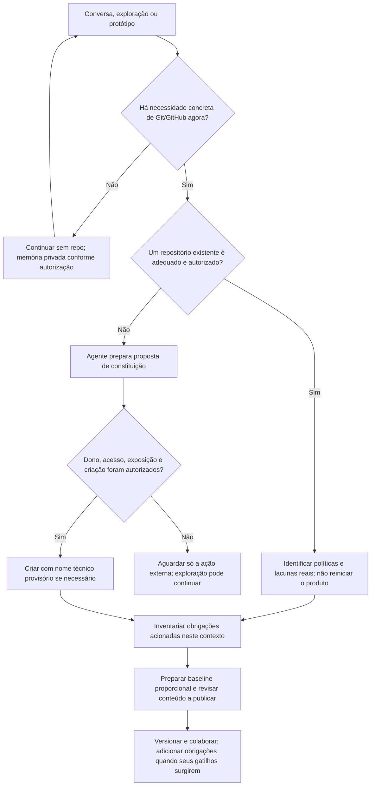

# Contrato documental: cada registro no seu devido momento

**Estado:** proposta integrante do workflow, ainda sem enforcement automático.

A [baseline do método](BASELINE-METODO.md) estabelece suas obrigações próprias:
METHODOLOGY, RULES, índice e bibliotecas de prompts/templates, com AGENTS antes
de execução delegada no repo e adaptadores/capacidades conforme adoção. Não
confundir essa infraestrutura prévia com formulários exigidos do humano.

## 1. Obrigatório para quê, por quem e a partir de quando?

Não existe um pacote universal de arquivos Markdown que todo repositório GitHub
precise conter. README, licença, CONTRIBUTING e ADRs não são, em conjunto, um
pré-requisito técnico universal para criar um repositório. Confundir recomendação,
obrigação jurídica, regra organizacional e requisito da plataforma produz
burocracia e falsas garantias.

Este contrato distingue:

| Origem da exigência | Significado | Quem resolve aplicabilidade |
| --- | --- | --- |
| Plataforma/ferramenta | Requisito técnico da operação escolhida | Responsável pela integração verifica a ferramenta e configuração efetivas |
| Organização | Política ou regra real do repositório/organização | Mantenedor identifica a política e sua versão |
| Jurídica/contratual | Obrigação vinculada a direitos, dados, setor ou contrato | Responsável competente valida; agente não presume conformidade |
| Método | Evidência que este pipeline exige para um compromisso específico | Autoridade do produto ratifica a adoção e as exceções |
| Convenção opcional | Facilita descoberta, colaboração ou automação | Mantenedor adota quando houver benefício |

Uma exigência condicional pode ser inegociável quando seu gatilho ocorre. Não
ser universal não significa ser dispensável. A lista abaixo é um catálogo-base;
setores, organizações, stacks e ferramentas podem acrescentar exigências.
O inventário de aplicabilidade de cada produto deve capturar essas diferenças.

**Unidade de obrigação é o registro útil, não necessariamente um arquivo novo.**
Uma decisão pode morar num documento existente ou numa aprovação de PR, desde
que tenha autoridade, revisão, motivo e referência recuperáveis. Conteúdo privado
pode permanecer em sistema autorizado, com referência de acesso restrito; não
deve ser copiado para o GitHub apenas para satisfazer um check.

## 2. Antes do repositório: direito à intenção ainda sem nome

O primeiro espaço é uma conversa, caderno ou workspace privado, sem obrigação de
repo, branch, issue, título definitivo ou linguagem de requisitos. Havendo memória
persistente autorizada, o agente pode preparar sínteses leves. O humano não precisa
preencher um template, aprovar cada anotação ou converter a inquietação em projeto.
Sem persistência disponível, o agente deve explicitar esse limite ao encerrar.

**Nome descritivo provisório não é decisão de identidade.** O harness pode usar
um ID interno para recuperar a conversa. Se a interface exigir um slug ou branch,
deve fornecê-lo como detalhe técnico reversível, não bloquear a pessoa com uma
pergunta para a qual ela ainda não tem resposta.

Um repositório existente para experimentos também não implica compromisso de
produto. Da mesma forma, um ZERO pode amadurecer antes de haver Git. Ao migrá-lo,
preservar procedência e ratificação identificável; não inventar SHA retrospectivo.

### Árvore de constituição do repositório

Criar repo, publicar conteúdo, mudar visibilidade e conceder acesso são operações
distintas. A autorização de uma não presume as demais. O nome técnico pode ser
proposto pelo agente; propriedade, exposição e permissões não são escolhas locais
que ele possa assumir silenciosamente.

## 3. Regras de nascimento, manutenção e dispensa

Para cada obrigação acionada, o agente mantém um registro no
[inventário de constituição](templates/CONSTITUICAO-REPOSITORIO.md), ou no
registro canônico equivalente já existente:

- Gatilho e ação que depende dele; origem da exigência.
- Artefato ou evidência canônica, revisão, localização e acesso.
- Quem prepara, quem decide e quem consome.
- Estado: `não acionado`, `pendente`, `rascunho`, `em revisão`, `vigente`,
  `não aplicável com motivo`, `exceção autorizada` ou `substituído`.
- Validade: qual mudança o torna desatualizado; quando rever.
- Consequência da ausência e, se admitida, exceção com autoridade e prazo/gatilho.

`Não acionado` não significa atraso. `Não aplicável` não é um arquivo vazio.
Um rascunho não satisfaz uma exigência de aprovação. Uma exceção do método não
dispensa obrigação legal ou política que seu autorizador não tenha poder de dispensar.

Documentar é, por padrão, trabalho assistido e visível: o agente prepara e mantém
com explicitação no chat de cada documento. O humano é chamado a decidir quando
há interpretação material, escolha reservada ou compromisso novo. Não precisa
ratificar cada atualização editorial, mas também não pode ser mantido alheio a ela.

### Protocolo de elaboração documental visível

Aplica-se a cada criação ou alteração documental, inclusive arquivos de instrução,
specs e tarefas gerados por ferramentas, corpos de PR e registros canônicos fora
do Git. Não basta uma mensagem genérica como "atualizei a documentação".

| Passo | O agente explicita no chat | Limite |
| --- | --- | --- |
| Antes de redigir | Nome/caminho ou registro, motivo e gatilho, conteúdo proposto, fontes e dúvidas materiais | Não impor formulário nem presumir uma resposta humana |
| Ao elaborar | O que veio do humano, o que é evidência, inferência, sugestão ou desconhecido | Não preencher lacunas com decisões fabricadas |
| Ao apresentar | Conteúdo integral quando curto; quando extenso, exposição substantiva por documento com compromissos, limites, divergências e acesso ao texto completo | Link, diff ou lista de arquivos sozinhos não são explicitação |
| Ao discutir | Correções e objeções humanas, alternativas abertas e efeito no texto | Ausência de objeção não significa concordância |
| Ao gravar | Identificação da versão e estado real: rascunho, proposto ou ratificado com evidência | Gravação pode preceder discussão apenas como rascunho, nunca como decisão consumada |
| Antes de usar como compromisso | Decisão solicitada, autoridade, escopo/revisão e aprovação efetivamente recebida | Não avançar com novo compromisso apenas porque o documento foi apresentado ou mergeado |

Documentos relacionados podem ser apresentados num único lote, desde que cada
um seja identificado e explicado individualmente no chat. Em caso de lote, a
rejeição ou pedido de correção de um documento suspende os demais documentos
dependentes do mesmo lote, salvo se o humano autorizar expressamente o avanço
parcial. Não é necessário interromper a cada parágrafo. Em rascunhos ainda não
ratificados, atualização editorial pode ser relatada de forma curta; porém, após
a ratificação de um documento, qualquer mudança de bytes presume-se material por
padrão e exige nova ratificação, sendo proibido ao agente autoclassificar uma
edição como "apenas editorial" sem declaração humana expressa.

Para documentos longos, dividir a discussão por partes coerentes quando necessário,
sem despejar texto para obter um "sim" exausto. Não esconder disposições materiais
no arquivo e pedir aprovação apenas de um resumo que as omite. O humano pode
pedir leitura integral, contestar uma seção, incubar a proposta ou voltar à
exploração. Não é obrigado a editar Markdown para participar.

**Estados distintos:** proposta redigida, conteúdo apresentado, resposta humana
recebida e compromisso ratificado são eventos diferentes. O agente pode registrar
o que apresentou, mas não afirmar que o humano leu, compreendeu ou concordou
sem manifestação correspondente. Aceites podem cobrir um conjunto delimitado
de documentos e revisões; não valem para alterações futuras indiscriminadas.

**Rastro mínimo por documento:** referência ao diálogo de origem, versão ou
conteúdo apresentado, fontes/interpretações relevantes, pendências e eventual
decisão humana. Usar metadados ou registro canônico existente, sem transcrever
conversas privadas. Se o chat não oferecer links estáveis, registrar data,
contexto e trecho mínimo identificável ou referência autorizada; não inventar
um identificador nem publicar conteúdo privado para simular rastreabilidade.

**Conteúdo gerado automaticamente:** inventários, referências e notas podem ser
gerados sob mandato, mas seu documento e delta relevante continuam apresentados
no chat; o agente não inventa leitura ou aprovação de cada linha. Artefatos
técnicos brutos, como logs, binários e resultados completos de testes, podem ser
referenciados com explicação de função, resultado e limitações, sem transcrição
integral. Essa distinção não permite esconder specs, decisões ou políticas como
"saída gerada".

**Correção de invisibilidade:** se um documento já tiver sido escrito sem esse
diálogo, apresentá-lo individualmente, explicitar suas escolhas e manter pendente
qualquer ratificação não obtida. Não retroagir ciência ou aprovação. A presente
proposta e os templates já preparados também estão sujeitos a essa regra.

## 4. Matriz temporal: antes, durante e depois

Nas linhas abaixo, exigências do método só passam a reger o produto após sua
adoção. Nenhuma linha exige refazer fases que já têm evidência adequada.

| Momento / ação | Registro antecedente | Registro durante ou posterior | Responsabilidade / consumo | O que fica impedido se faltar |
| --- | --- | --- | --- | --- |
| Expressar inquietação | Nenhum formulário | Memória leve se desejada e autorizada | Agente acolhe; humano explora | Nada: a conversa continua |
| Brainstorm / ideação | Contexto disponível, mesmo incompleto | Síntese seletiva, alternativas e tensões em EXPLORAÇÃO | Agente prepara; humano corrige sentido quando necessário | Não declarar convergência inexistente |
| Sessão grill me | Acordo de objetivo, intensidade e parada, que pode estar na conversa | Objeções relevantes, respostas e incógnitas na mesma exploração | Interlocutores; consumidor é a próxima decisão | Não impor provocação não combinada |
| Pesquisa / engenharia reversa | Pergunta e limites de acesso, uso e gasto quando aplicáveis | Fontes, datas, proveniência, licenças/limites e inferências | Agente pesquisa; responsável valida decisões materiais | Não alegar descoberta sem fonte nem extrapolar autorização |
| Protótipo / experimento | Hipótese/pergunta, limites e procedimento proporcionais ao risco | Resultado, evidências, limitações e destino dos artefatos em EXPLORAÇÃO | Executor prepara; decisor usa aprendizado | Não executar efeitos externos sem autorização nem promover código automaticamente |
| Pausa / abandono / retomada | Nenhuma justificativa compulsória | Estado e contexto mínimo para retomada, se memória desejada | Agente preserva; humano escolhe continuar | Nada obriga construção |
| Compactação / sucessão de session-agent | Registros persistentes existentes e estado atual; contrato de memória | Checkpoint dos dois nomes, resultado do hook e recibo real de recuperação | Agente predecessor/adaptador preservam; sucessor confere | Não declarar continuidade garantida com pacote ausente/parcial; contenção depende de capacidade real do harness |
| Constituir repo / incorporar a repo existente | Motivo, destino e autorizações aplicáveis; políticas existentes | Constituição e inventário de aplicabilidade | Agente propõe; dono autoriza; mantenedor usa | Apenas a operação de repo sem autorização; não a exploração |
| Primeiro versionamento compartilhado | Revisão do conteúdo publicável, direitos e segredos; baseline acionada | README factual, ignore rules e registro de procedência aplicáveis | Mantenedor e colaboradores | Publicação de material não autorizado ou sensível |
| Fundar compromisso de produto | Exploração selecionada ou procedência de decisão recebida | ZERO, lacunas, risco residual e ratificação da revisão | Agente redige; autoridade humana ratifica | Não iniciar execução produtiva sob intenção ainda não ratificada |
| Propor mudança de intenção | ZERO vigente e sinal motivador | requirement-NNNN; emenda ao ZERO se alterar fundamento | Autoridade do produto e futuros revisores | Não apresentar mudança de contrato como simples execução |
| Preflight / simulação temporal | Requisito candidato, decisões e riscos relevantes | Cenários, premissas, limites, resultados e encaminhamento | Agente prepara; autoridade aceita riscos sob seu domínio | Decisão afetada por lacuna impeditiva; não toda atividade |
| Assumir decisão arquitetural relevante | Opções, forças e consequências proporcionais | ADR aceito e referência à decisão/revisão | Decisor identificado; specs e manutenção consomem | Não tratar proposta como decisão aceita |
| Especificar | Requisito ratificado para execução; rascunhos podem elaborá-lo antes | Specs nativas, critérios e mapa de cobertura | Agente especifica; responsável resolve conflitos | Não executar contrato divergente ou sem cobertura material |
| Delegar tarefas | Specs, dependências e limites de execução | Tarefas canônicas e mandato na ponte | Humano autoriza decisões reservadas; agente executa | Execução fora do mandato, não escolhas locais delegadas |
| Abrir branch de trabalho | Necessidade de isolar/versionar uma mudança e regras existentes | Referência à iniciativa no PR ou metadado equivalente | Agente pode sugerir/gerar nome técnico | Não exigir escolha de naming como decisão de produto |
| Implementar / corrigir | Critério vigente, tarefa e mandato; para bug, reprodução do contrato violado | Código, testes e evidência de execução | Executor; revisão e CI consomem | Alegar correção sem evidência ou alterar contrato silenciosamente |
| Abrir PR | Diff real, origem do escopo e referências disponíveis | Corpo de PR, checks, riscos e pedidos decisórios | Autor prepara; revisores e CI consomem | Merge antes das condições aplicáveis; draft pode existir com pendências explícitas |
| Revisar / pedir alteração | Revisão concreta do PR e evidências | Review, threads, respostas e pendências nativas do GitHub | Revisores autorizados; autor responde | Não simular aprovação nem resolver divergência apagando registro |
| Fazer merge | Checks e autorizações atuais, resolução das pendências bloqueantes | Merge/SHA e relação com entrega | Integrador autorizado; release consome | Integração sem critérios vigentes; merge não significa deploy |
| Liberar / migrar | Artefato identificado, plano de release, recuperação, observação e autorização | Release/deployment, migração aplicada e registro DEL | Responsável pela release/operação | Liberação não autorizada ou sem tratamento de riscos materiais |
| Observar / aprender | Sinais, fonte, janela e responsável definidos | Resultado real em DEL; novo requisito se necessário | Operação/produto; próxima exploração consome | Não declarar benefício sem observação |
| Responder a incidente | Canal, responsabilidades e runbook aplicáveis já preparados | Linha do tempo, contenção, evidências restritas e aprendizado proporcional | Responsável por incidente; autoridades pertinentes | Não atrasar contenção para preencher relatório; não dispensar autorização exigida |
| Descontinuar / arquivar | Impacto em usuários, dados, obrigações e plano autorizado | Avisos aplicáveis, destino dos dados, suporte e documentação atualizados | Dono e responsáveis competentes | Não confundir abandono de ideia com encerramento de serviço em uso |

O [registro de passagem](templates/REGISTRO-PASSAGEM.md) fornece os campos
comuns quando não existir suporte canônico. Não se cria um arquivo por clique,
comando ou comentário: só decisões, transições e evidências que precisem sobreviver.

## 5. Catálogo de arquivos e configurações de repositório

Os caminhos são destinos sugeridos para o produto adotante, não arquivos todos
instalados por esta proposta. Onde indicado, o requisito é o conteúdo; um
equivalente canônico evita duplicação.

| Artefato / localização sugerida | Origem e gatilho de exigibilidade | Preparação / autoridade | Manutenção e limite |
| --- | --- | --- | --- |
| `METHODOLOGY.md` | Método: adoção da infraestrutura metodológica, mesmo antes do repo do produto | Agente apresenta; responsável pelo método decide | Porta de entrada para o ciclo canônico, sem duplicá-lo |
| `RULES.md` | Método: antes de trabalho assistido governado pelo método | Agente apresenta; autoridade define regras | Separar regras, decisões e permissões reais |
| `INDEX.md` ou mapa canônico identificado | Método: baseline documental adotada | Agente mantém com explicitação no chat | Referências e responsabilidades; índice não comprova leitura |
| Biblioteca `prompts/` | Método: infraestrutura reutilizável; roteiros instanciados conforme atividade | Agente propõe; responsável adota | Prompt não é documento preenchido nem comando instalado |
| Biblioteca `templates/` | Método: disponibilidade de registros por gatilho | Agente mantém; responsável pelo método | Não exigir preenchimento antecipado nem gerar documentos silenciosamente |
| `CLAUDE.md` e outros adaptadores específicos | Condicional: integração adotada exige descoberta/formato próprio | Mantenedor valida; agente prepara | Encaminhar às regras canônicas, sem política concorrente |
| Inventário de skills e MCPs | Método condicional: antes da adoção/alteração da capacidade | Agente apresenta procedência e contratos; autoridade autoriza ações | Estado, acesso, efeitos, instalação/remoção; não versionar credenciais |
| `sledge-handoff.md`, `DIAMOND.md` | Método: persistência e passagem antes da compactação; funções particulares ainda não definidas | Predecessor preserva; sucessor recupera; humano define semântica futura | Localização privada proposta em `.session-memory/`; não fabricar conteúdo nem publicar automaticamente |
| Envelope de checkpoint e recibo | Método: coerência e recuperação verificável da passagem | Adaptador/agentes; resultado real do hook | Contrato em MEMORIA-SESSOES; ignore não garante retenção nem transporte entre worktrees/hosts |
| `llms.txt` / `robots.txt` | Convenção/contexto web, quando finalidade e consumidores justificarem | Responsável pela publicação | Orientação a LLMs e rastreamento são funções distintas; não controlam acesso nem governam execução local |
| `README.md` | Método: primeiro compartilhamento versionado | Agente prepara; mantenedor responde pelo conteúdo | Informar propósito provisório, maturidade e orientação; atualizar com uso/instalação reais, sem exigir nome comercial |
| `.gitignore` e regras locais de exclusão | Método: antes de versionar artefatos gerados, locais ou sensíveis | Agente propõe conforme stack; mantenedor revisa | Ajustar com tooling; ignore não remove segredo já rastreado nem substitui resposta à exposição |
| `LICENSE` / `LICENSES/` | Condicional: decisão de licenciamento e direitos aplicáveis antes de distribuir sob licença declarada | Titular ou autoridade competente escolhe; agente não inventa licença | Atualizar ao mudar distribuição/direitos; repo público não equivale a licença aberta |
| `NOTICE`, atribuições e avisos de terceiros | Jurídica/contratual quando licenças de material incorporado exigirem | Responsável por distribuição valida; agente inventaria | Reexaminar dependências e redistribuição; não presumir NOTICE universal |
| `docs/requirements/REQUIREMENT-ZERO.MD` | Método: primeiro compromisso de produto, não criação do repo | Agente sintetiza; autoridade da intenção ratifica | Emendar explicitamente quando fundamento mudar |
| `docs/requirements/requirement-NNNN.md` | Método: mudança/expansão da intenção | Agente prepara; autoridade do produto ratifica | Estado, vínculos e efeitos no ZERO; bug que restaura contrato não exige novo requisito |
| `docs/explorations/EXP-NNNN.md` | Método: aprendizado selecionado precisa sustentar decisão futura | Agente sintetiza com limites de publicação | Pode nascer fora do repo e receber ID depois; transcrição não é obrigação |
| `docs/decisions/ADR-NNNN.md` | Método condicional: decisão material com consequências persistentes | Agente prepara; decisor competente aceita | Registrar substituição e condições de revisão; não exigir ADR para toda tarefa |
| Specs, plano e tarefas nativos do executor | Método: antes da execução correspondente | Agente prepara; responsável aceita contrato e mandato | Caminhos definidos ao escolher executor; não criar segunda fonte da verdade |
| Ponte e mandato de execução | Método: antes de trecho autônomo | Agente propõe; autoridade delegante autoriza | Revisar com escopo, evidência ou limites novos |
| `CONTRIBUTING.md` | Método condicional: antes de abrir contribuição a outras pessoas/agentes | Mantenedor estabelece; agente documenta | Setup, testes, branches, PRs e revisão; não exigir do autor de uma ideia |
| `CODE_OF_CONDUCT.md` | Condicional: política comunitária/organizacional antes de abrir comunidade sob essa política | Responsáveis pela comunidade definem texto e aplicação | Canal real, responsáveis e procedimento; não inventar compromisso de moderação |
| `SECURITY.md` | Método condicional: antes de disponibilizar software a usuários externos | Mantenedor de segurança valida | Canal de reporte, versões suportadas e processo real; não publicar detalhes de vulnerabilidade privada |
| `SUPPORT.md` ou seção canônica de suporte | Método condicional: antes de convidar usuários a depender do software | Responsável pelo suporte | Canais, limites e ciclo de suporte; evitar promessa de SLA inexistente |
| `CODEOWNERS` em localização reconhecida pelo GitHub | Condicional: quando o fluxo usar roteamento/revisão por donos de código | Mantenedor valida donos reais | Sintaxe, cobertura e permissões; arquivo sozinho não exige aprovação |
| `.github/ISSUE_TEMPLATE/` e configuração associada | Opcional ou organizacional: quando intake estruturado ajudar coordenação | Mantenedor define mínimo útil | Templates distintos para bugs e propostas; não converter exploração inicial em formulário obrigatório |
| `.github/PULL_REQUEST_TEMPLATE.md` ou templates de PR | Opcional ou organizacional: quando padronizar evidência ajudar revisão | Mantenedor; agente adapta bloco DEL | O método exige informação aplicável no PR, não este arquivo específico |
| `AGENTS.md` e instruções de ferramentas adotadas | Método condicional: antes de execução delegada recorrente no repo | Mantenedor define contrato; agente prepara | Comandos reais, escopo, limites e fontes canônicas; não duplicar políticas divergentes nem segredos |
| Manifests, lockfiles e configuração de build/teste | Técnica/organizacional conforme stack: antes de build reproduzível e CI correspondente | Responsável de engenharia | Registrar versão de runtime e comandos; lockfile apenas onde ecossistema/projeto o adota |
| `.env.example` ou contrato equivalente de configuração | Método condicional: quando setup exigir variáveis externas | Agente documenta nomes e exemplos inócuos; mantenedor valida | Nunca valores reais; segredos em mecanismo autorizado, não no Git |
| `.github/workflows/*.yml` e scripts invocados | Técnica: ao adotar GitHub Actions; método: CI antes de integrar código produtivo | Mantenedor autoriza política; agente implementa | Eventos, permissões, checks e dependências reais; não instalar workflow vazio como conformidade |
| Rulesets/branch protection, environments e permissões | Organizacional/método: antes de depender de gates de merge/deploy | Administrador autorizado configura | São configurações remotas, não prova por arquivo; inventariar regra efetiva e limitações do plano |
| Configuração de atualização de dependências, como `.github/dependabot.yml` | Opcional ou organizacional: quando adotar automação correspondente | Mantenedor | Alternativas equivalentes válidas; alertas não substituem resposta e triagem |
| `CHANGELOG.md` ou release notes canônicas | Método: antes de anunciar versão com impacto a usuários | Agente prepara a partir do diff; responsável pela release valida | Uma fonte canônica; incluir incompatibilidades e migração, sem changelog fictício de intenção |
| Guia de uso, instalação, operação e migração | Método condicional: antes do uso, operação ou migração correspondente | Engenharia/operação e produto | Pode estar no README ou em `docs/`; refletir versão entregue e recuperação |
| `docs/deliveries/DEL-NNNN.md` ou registro equivalente | Método: preparação de entrega e observação | Agente consolida; responsáveis por release e resultado | Referenciar PR, artefato, ambiente e observação; não copiar logs integrais |
| Modelo de ameaças e registros de privacidade, dados e acessibilidade | Condicional: riscos, públicos, contratos e obrigações aplicáveis | Especialistas/responsáveis competentes; agente auxilia | Preparar antes das decisões/ações afetadas; evidências sensíveis ficam restritas |
| Runbooks, plano de incidente, recuperação e continuidade | Método condicional: antes de operar serviço com responsabilidade assumida | Operação e dono do serviço | Exercitar conforme risco; relatório de incidente nasce depois, não bloqueia contenção |
| SBOM, proveniência, assinatura e atestações | Condicional: distribuição, contrato, supply chain ou política exige | Responsável pelo build/release | Frequentemente artefatos gerados da versão exata, não Markdown manual nem inventário presumido |
| `CITATION.cff`, `.github/FUNDING.yml`, roadmap público e similares | Opcional ou contextual: citação, financiamento ou comunicação adotados | Responsável pelo conteúdo/compromisso | Não são baseline universal; atualizar somente quando funcionalidade/comunicação for usada |
| Política de descontinuação e aviso de encerramento | Condicional: retirada de produto usado por terceiros ou obrigação contratual | Dono e responsáveis por suporte/dados | Prazos, migração e retenção reais; não confundir arquivar repo com apagar dados de usuários |

Inventário completo não significa catálogo fechado: antes da ação afetada,
verificar obrigações externas adicionais e registrar sua fonte. Uma instrução
encontrada em documento de terceiro não concede permissão de acesso ou publicação.

## 6. Documentos não são a mesma coisa que registros do GitHub

Issues, comentários, aprovações, threads, checks, artifacts, merges, releases,
deployments e configurações remotas podem ser evidências canônicas. Não exportar
tudo para Markdown por hábito.

Para uma evidência nativa, conservar identificação, revisão/SHA quando aplicável,
resultado, responsável e referência. Levar em conta retenção, acesso e perda de
artefatos: se a prova precisar durar mais que o sistema permite, definir
preservação autorizada antes que expire. Não usar URL temporária como única
evidência de longo prazo.

Em particular:

- Aprovação de PR só ratifica intenção se o papel e o significado da aprovação
  estiverem explícitos; review técnico não é automaticamente aceite do produto.
- CI verde é resultado de execução sobre uma revisão, não aprovação humana.
- Configuração escrita num plano não comprova regra habilitada no GitHub.
- Documento cujo autor escreveu "aprovado" não prova aprovação de outra pessoa.

## 7. Validação futura: cobrar a ocasião, não a existência antecipada

O validador documental proposto deve avaliar:

1. Qual ação ocorre agora e quais gatilhos realmente foram acionados?
2. Qual origem torna cada evidência exigível?
3. Existe registro canônico vigente, acessível aos responsáveis e ligado à revisão?
4. Cada documento foi explicitado no chat, com conteúdo substantivo e pendências,
   e há rastro da apresentação da versão relevante?
5. Há pendência impeditiva, não aplicabilidade fundamentada ou exceção válida?
6. Qual ação específica deve parar e qual trabalho pode continuar?

Um check pode verificar referências e campos, não provar compreensão humana.
O agente não pode preencher por conta própria um campo "humano ciente".

Exploração sem repo fica fora do gate de PR. Protótipo não herda automaticamente
exigências de release. Ao incorporar trabalho maduro, inventariar somente lacunas
reais; registro retrospectivo identificado é permitido, evidência inventada não.
Ausência de licença pode impedir distribuição sob uma licença declarada, mas não
impede conversar sobre a ideia. Ausência de autorização de deploy impede deploy,
não impede necessariamente preparar documentação ou corrigir um teste local.

O resultado deve explicar causa e ação afetada. Não produzir um placar de
"completude documental" que premie arquivos vazios ou penalize exploração.

## 8. Caminhos exemplares

**Inquietação ainda inarticulada:** conversa → memória opcional → exploração →
talvez pausa. Zero nomes obrigatórios, zero repo exigido, zero tarefas impostas.

**Protótipo antes de identidade:** pergunta → limites do experimento → sandbox
local ou repo autorizado com ID provisório → resultado → descartar ou sintetizar
ZERO. Código experimental não vira compromisso por existir.

**Produto com direção madura:** procedência → ZERO/requisito ratificado →
inventário de obrigações acionadas → decisões/specs existentes ou complementadas →
mandato → implementação → PR → merge → entrega → observação.

**Correção em produto existente:** contrato vigente → reprodução → tarefa sob
mandato → teste/correção → PR/revisão → entrega. Sem novo ZERO nem novo requisito,
salvo se a solução mudar a intenção ou o comportamento contratado.
