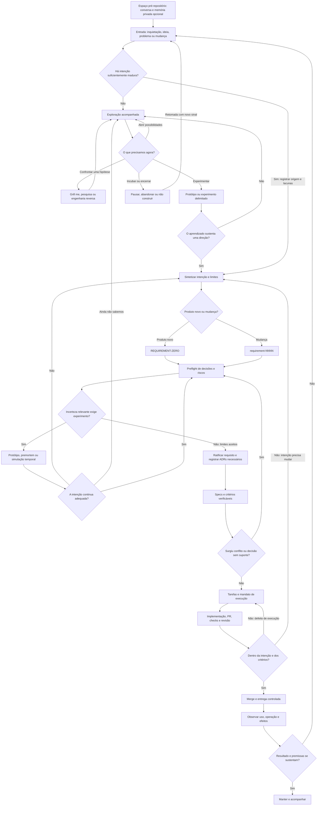

# Da inquietação à produção

> Uma proposta de workflow em que a intenção humana pode amadurecer antes de
> virar compromisso, e o compromisso pode ser acompanhado até seus efeitos reais.

**Estado:** proposta para discussão, não política já aprovada.

**Entrada metodológica:** [METHODOLOGY.md](../../METHODOLOGY.md).
**Regras canônicas:** [RULES.md](../../RULES.md).
**Mapa documental:** [INDEX.md](../../INDEX.md).
O desenho foi autorizado para elaboração; isso não ratifica automaticamente
detalhes operacionais nem compromissos de um produto futuro.

## 1. O que este método procura corrigir

O trabalho pode começar com insatisfação, curiosidade, oportunidade, uma ideia de
solução ou uma decisão já tomada. Nenhuma dessas entradas exige fabricar uma
história de descoberta que não aconteceu.

O método conecta trabalho criativo e exploratório a desenvolvimento orientado
por especificações e por tarefas. Não substitui um executor como Spec Kit ou
OpenSpec: define o contexto, a intenção e os limites que esse executor recebe,
e como seus resultados retornam ao ciclo do produto.

O humano é autor e interlocutor da intenção, representante inicial dos futuros
usuários e autoridade sobre compromissos delegados. Não é fiscal de cada passo
do agente. Sua representação dos usuários é uma fonte relevante, mas não deve
ser apresentada como pesquisa com usuários que não ocorreu.

## 2. Invariantes

1. **Companhia antes de cobrança.** Uma inquietação pode ser explorada sem nome
   de produto, justificativa econômica, formulário ou obrigação de continuar.
2. **Divergência não é defeito.** Alternativas, contradições e ideias descartadas
   podem ser conhecimento útil; não são automaticamente tarefas pendentes.
3. **Provocação tem contexto.** Grill me pode ser uma sessão estruturada e
   deliberadamente intensa, ou uma intervenção pontual. Objetivo, intensidade e
   condição de encerramento são combinados; não se torna interrogatório permanente.
4. **Aprender não é prometer.** Protótipos e simulações não autorizam implementação
   produtiva, nem convertem hipóteses em evidência observada.
5. **A entrada é variável.** Uma iniciativa madura começa adiante, com procedência,
   limites e lacunas explícitos; não precisa repetir ritos já desnecessários.
6. **Autonomia tem fronteira.** O agente executa dentro de um mandato e interrompe
   quando o ultrapassa, não em cada escolha local reversível.
7. **Discordância não desaparece por resumo.** Sínteses distinguem voz humana,
   interpretação do agente, evidência e decisões efetivamente ratificadas.
8. **Produção reabre perguntas.** Efeitos observados podem provocar novas
   explorações, requisitos e revisões das premissas fundadoras.
9. **Infraestrutura não define maturidade.** Conversar não exige repositório,
   nome de produto, slug ou branch. Identificadores técnicos provisórios podem
   ser gerados sem solicitar uma decisão de identidade ao humano.
10. **Documentação tem ocasião.** Cada obrigação precisa de gatilho, responsável,
    consumidor e consequência de ausência; nenhum catálogo inteiro é exigido
    na entrada. O agente prepara os registros, não terceiriza seu preenchimento
    ao humano como condição para ajudá-lo.
11. **Documentação nasce à vista.** Cada documento criado ou alterado é explicitado
    no chat, com finalidade, conteúdo substantivo, procedência e pendências.
    Redigir não é decidir; apresentar não é obter ciência comprovada; silêncio,
    existência do arquivo e merge não ratificam interpretações do agente.

## 3. Árvore de entrada, decisão e retorno

As caixas são estados de trabalho, não departamentos nem cerimônias obrigatórias.
Os retornos podem atravessar mais de uma caixa.



**Atalho legítimo:** decisões, specs e tarefas preexistentes podem levar
diretamente ao estado correspondente, desde que os requisitos relevantes estejam
ratificados, as referências sejam recuperáveis e as lacunas críticas estejam
resolvidas ou aceitas pela autoridade competente. Não se exige reproduzir
exploração, protótipo ou ADR desnecessário.

**Ausência de documentação anterior:** registrar uma base retrospectiva curta,
identificada como tal, e submeter sua interpretação à ratificação humana.
Não inventar validações, consenso ou alternativas supostamente avaliadas.

**Nascimento do repositório é uma decisão independente:** pode ocorrer durante
um protótipo, depois do ZERO ou já ter ocorrido. Não é condição para a exploração
nem consequência automática da síntese de intenção. Aplicar a árvore e os
gatilhos do [contrato documental](CONTRATO-DOCUMENTAL.md) quando houver necessidade
de versionamento, colaboração ou execução integrada.

## 4. Estados e evidências mínimas

| Estado | Trabalho permitido | Condição para avançar |
| --- | --- | --- |
| Exploração | Conversar, divergir, pesquisar, simular, questionar, pausar | Humano reconhece uma direção que merece síntese; não apenas agente declara conclusão |
| Prototipagem exploratória | Testar uso, viabilidade ou outra hipótese delimitada | Aprendizado e limitações registrados; decidir descartar, experimentar novamente ou sintetizar |
| Síntese de intenção | Preparar ZERO ou requisito numerado | Intenção reconhecível, fronteiras, lacunas e autoridade identificadas |
| Preflight | Examinar decisões candidatas e riscos; testar cenários | Riscos materiais examinados; lacunas impeditivas resolvidas e riscos residuais aceitos |
| Compromisso | Ratificar requisito e aceitar ADRs necessários | Registro explícito da decisão e da revisão documental que foi ratificada |
| Especificação | Descrever comportamento e critérios verificáveis | Cobertura rastreável da intenção; conflitos devolvidos ao preflight |
| Execução | Decompor e implementar sob mandato | PR com evidências proporcionais ao risco e checks aplicáveis |
| Entrega | Revisar, integrar, liberar e observar | Autorizações aplicáveis, estratégia de recuperação e sinais de resultado |
| Aprendizado | Comparar efeitos reais às expectativas | Manter, corrigir defeito, abrir mudança ou reconsiderar fundamento |

Cada estado pode conter ciclos internos. Uma lacuna só impede avanço quando
ameaça a validade da decisão seguinte. O responsável deve explicar esse nexo,
em vez de exigir completude documental abstrata.

## 5. A posição do humano e o mandato do agente

O contrato é de **autonomia delimitada por intenção**, não abandono nem supervisão
contínua. A frequência de interação depende do trabalho: exploração pode precisar
de conversa intensa; execução bem delimitada pode precisar apenas de checkpoints.

Antes de um trecho autônomo, combinar:

- Resultado buscado, referências ratificadas e o que não pode ser alterado.
- Ações permitidas, limites de custo, tempo, acesso e efeitos externos.
- Decisões delegadas e decisões reservadas a uma pessoa ou papel.
- Condições de interrupção, checkpoint e encerramento.
- Forma de relatar resultados sem despejar logs ou pedir decisões triviais.

**Interromper:** conflito com intenção, necessidade de ampliar escopo, evidência
que invalida premissa relevante, ação fora da autorização, risco material novo
ou tentativas que atingem o limite combinado.

**Não interromper por padrão:** escolha local reversível, correção de teste
introduzido pela própria implementação ou refatoração dentro do escopo autorizado.
Políticas da ferramenta e do repositório continuam prevalecendo.

Consolidar perguntas relacionadas no checkpoint; apresentar alternativas,
consequências e recomendação. Falta de resposta nunca significa aprovação.

## 6. Contrato documental e rastreabilidade

METHODOLOGY, RULES, INDEX e as bibliotecas de prompts/templates constituem
infraestrutura do método, disponível antes do produto. A
[baseline](BASELINE-METODO.md) define sua incorporação ao repo e os gatilhos de
AGENTS, adaptadores, skills e MCPs. Não são perguntas iniciais ao criador.

O [contrato documental por momento e ação](CONTRATO-DOCUMENTAL.md) complementa
esta arquitetura: prevê arquivos de repositório, anotações, registros nativos do
GitHub, obrigações condicionais e os eventos que os tornam necessários.
O catálogo não é um checklist de abertura.
Seu protocolo de elaboração visível rege todos esses registros: antes da redação,
identificar no chat cada documento e sua proposta; depois, apresentar o conteúdo
ou delta substantivo, interpretações e pontos que exigem decisão. Rascunhos podem
ser gravados como rascunhos; compromissos novos não entram em execução sem a
ratificação aplicável. Atualizações editoriais são comunicadas sem nova cerimônia
de aprovação. O humano não precisa descobrir decisões lendo um diff surpresa.

Esta é a organização sugerida para um produto que adotar o método. Os arquivos
de exemplo abaixo não são documentos de produto já preenchidos.

```text
docs/
  requirements/
    REQUIREMENT-ZERO.MD
    requirement-0001.md
    requirement-0002.md
  explorations/
    EXP-0001.md
  decisions/
    ADR-0001.md
  specs/
    <documentos nativos do executor escolhido>
  deliveries/
    DEL-0001.md
```

| Documento | Responsabilidade | Não deve virar |
| --- | --- | --- |
| [Exploração](templates/EXPLORACAO.md) | Preservar alternativas, perguntas e aprendizado selecionado | Transcrição compulsória ou formulário de entrada |
| [REQUIREMENT-ZERO](templates/REQUIREMENT-ZERO.MD) | Fundar a intenção, o sentido e os limites do produto | Constituição imutável, PRD exaustivo ou arquitetura disfarçada |
| [requirement-NNNN](templates/requirement-NNNN.md) | Fundamentar uma mudança ou expansão e seus efeitos no ZERO | ID de cada requisito atômico ou tarefa de implementação |
| [Preflight e ADR](templates/PREFLIGHT-ADR.md) | Examinar alternativas e consequências; registrar decisão quando justificada | Ritual obrigatório para toda alteração |
| [Ponte para specs e tarefas](templates/PONTE-SPECS-TAREFAS.md) | Traduzir compromisso em contrato de execução rastreável | Segunda cópia divergente das specs e tarefas |
| [Entrega e aprendizado](templates/ENTREGA-APRENDIZADO.md) | Ligar PRs, release, recuperação e efeitos observados | Suposição de que merge equivale a sucesso em produção |

**Identidade:** ZERO é único por produto. A sequência `0001`, `0002` etc. identifica
iniciativas de mudança, não substitui versões do ZERO e não é reiniciada por
release. Antes de haver repositório, IDs locais provisórios bastam e não precisam
ser escolhidos pelo humano. Reservar o próximo número pela coordenação do
repositório quando o registro for incorporado; não reutilizar
IDs de iniciativas abandonadas. Em trabalhos concorrentes, resolver colisões
antes do merge.

**Versionamento:** a história Git conserva revisões dos documentos. A ratificação
refere-se a uma revisão concreta: SHA, PR ou registro equivalente identificável.
Mudança material no texto exige nova ratificação; aprovação de versão anterior
não autoriza escopo acrescentado depois.

**Mudança do fundamento:** um requisito numerado deve declarar se preserva,
estende ou contradiz o ZERO. Se alterar fundamento, incluir emenda explícita ao
ZERO no mesmo conjunto de revisão, com razão, efeitos e nova ratificação.
Não reescrever o passado para fingir continuidade.

**Cadeia:** intenção → requisito e sua revisão → decisão, quando necessária →
critério de spec → tarefa → PR/check → release → observação.
Uma relação pode ter múltiplos destinos. Corrigir um bug que restaura um contrato
existente não exige novo requisito numerado; mudar o contrato exige.

Usar IDs locais estáveis para critérios e tarefas. Evitar duplicar o conteúdo
nativo de Spec Kit ou OpenSpec: manter referências e mapa de cobertura. A escolha
do executor e seu mapeamento concreto permanecem em aberto.

## 7. Preflight e simulações que atravessam o tempo

O primeiro preflight lista decisões candidatas, não decisões já aceitas. Escolhas
provisórias de um protótipo devem ser identificadas como tal. O preflight pode
retornar à exploração; uma spec também pode revelar a necessidade de novo ADR.

Aplicar premortem, experimentos e simulações temporais conforme o risco, não como
um pacote obrigatório. Para cada cenário selecionado, registrar premissas,
mecanismo de análise, consequências previstas, sinais de invalidação e resposta.

Horizontes e cenários possíveis: crescimento ou queda de uso, custo acumulado,
migração, saída de fornecedor, mudança regulatória, troca de mantenedor,
recuperação de dados, acessibilidade e envelhecimento de dependências.

**Separação epistemológica:** conversa simulada com usuário não é entrevista;
projeção de escala não é benchmark; premortem não é incidente observado; parecer
de outro agente não é validação independente por si só. Quando não for possível
testar, registrar risco residual, responsável e gatilho de revisão.

## 8. GitHub: coordenação sem transformar exploração em ticket

### Issues e branches

Exploração não exige sequer repositório, muito menos issue ou branch por conversa.
Se a ferramenta hospedeira exigir branch ou workspace, o harness fornece um
identificador técnico provisório; essa limitação não vira pergunta de produto.
Publicar apenas a síntese
selecionada pelo humano, sem segredos, dados pessoais ou transcrições privadas.
Uma issue passa a ser útil quando há trabalho a coordenar; aponta ao requisito
canônico e pode agregar experimentos, decisões e PRs.

Protótipos executáveis ficam isolados e identificados como experimentais.
Promovê-los a código produtivo exige o mesmo contrato de intenção, critérios e
revisão de qualquer implementação; demonstração convincente não dispensa isso.

### Classes de PR

| Classe declarada | Evidência esperada |
| --- | --- |
| Exploração/documentação | Aprendizado ou mudança documental e limites; sem alegar entrega funcional |
| Experimento/protótipo | Hipótese, procedimento, resultado e isolamento de efeitos |
| Requisito/decisão | Revisão proposta, divergências e ratificação por autoridade identificada |
| Implementação | Requisito ratificado, critérios, testes e decisões relevantes |
| Correção | Contrato vigente, reprodução, correção e não regressão |
| Release/operação | Revisão liberada, autorização, recuperação e observação |

Um PR pode combinar classes, mas recebe a união das exigências aplicáveis.
Declarar "documentação" não exclui verificações se houver código executável.
O [template de entrega](templates/ENTREGA-APRENDIZADO.md) contém um bloco para PR;
ele não foi instalado como template obrigatório do repositório.

### Contrato proposto para GitHub Actions

Actions pode verificar estrutura, referências e comportamento. Não pode
certificar que uma ideia amadureceu nem ratificar a intenção pelo humano.

| Check lógico proposto | Verifica | Limite |
| --- | --- | --- |
| `workflow-integrity` | Referências resolvíveis, IDs únicos, documentos exigidos para a classe e cobertura declarada | Presença não prova qualidade semântica |
| `scope-policy` | Arquivos alterados, classe efetiva e regras aplicáveis, sem confiar apenas no rótulo do autor | Mudança fora do mandato exige revisão humana |
| Checks de engenharia | Lint, tipos, testes, build e outros controles aplicáveis | Testes verdes não provam valor nem cobrem toda a intenção |
| Gate de integração | Checks exigidos e revisões/autorização da revisão atual | Merge não autoriza automaticamente deploy produtivo |
| Gate de entrega | Artefato/revisão, ambiente e autorização de release | Saúde operacional não demonstra benefício ao usuário |

Esses nomes são um desenho de interface; **não existem como novos jobs neste
repositório**. A implementação futura deve:

- Manter um check agregador estável que execute também em PRs documentais e
  indique explicitamente verificações não aplicáveis, sem checks requeridos
  eternamente pendentes por filtros de caminhos.
- Se adotar merge queue, cobrir o evento `merge_group` nos checks requeridos.
- Aplicar classificação a partir do diff e política confiável, não só de texto
  livre ou labels editáveis no PR.
- Tratar conteúdo de PR como entrada não confiável; não executar código de forks
  com segredos ou privilégios de escrita. Não usar `pull_request_target` para
  executar código da contribuição.
- Adotar permissões mínimas e referências de Actions fixadas em revisões
  verificadas. Não conceder ao agente aprovação de sua própria exceção.
- Invalidar ratificações materialmente afetadas por mudanças posteriores;
  branch rules, revisores autorizados e environments devem refletir isso.
- Prever exceção emergencial explícita: motivo, autoridade, escopo, risco,
  recuperação e revisão posterior. Não esconder bypass como sucesso normal.

O workflow existente, `.github/workflows/smard-ide.yml`, permanece intacto.
Seus checks de Rust e artefatos são evidência de engenharia, não ratificação
de requisitos nem comprovação de deploy. Este desenho não configura branch
protection, environments, merge queue ou acesso.

## 9. Fechamento do ciclo

Antes de entregar, definir o que será observado, durante quanto tempo e por quem.
Separar saúde técnica de resultado humano. Registrar o que ocorreu, inclusive
ausência de dados; uma janela de observação encerrada sem medição não é sucesso.

Possíveis desfechos: manter; corrigir defeito; abrir requisito numerado;
reexplorar problema; reverter entrega; retirar produto. Rollback deve respeitar
dados e migrações: reverter um binário pode não desfazer efeitos irreversíveis.

## 10. Adoção proporcional e decisões ainda abertas

Uma primeira iniciativa precisa apenas dos registros necessários para sua
próxima decisão. Não preencher todos os templates para provar adesão ao método.
Os templates de [constituição do repositório](templates/CONSTITUICAO-REPOSITORIO.md)
e [registro de passagem](templates/REGISTRO-PASSAGEM.md) são preparados pelo
agente quando seus gatilhos ocorrerem, não entregues como formulários iniciais.
Um ZERO inicial pode ser curto e conter perguntas em aberto; sua ratificação
depende de elas não inviabilizarem o compromisso autorizado.

Este desenho ainda precisa de decisão do responsável pelo produto sobre:

- Executor de specs/tarefas e mapeamento de seus artefatos nativos.
- Papéis reais, autoridade de ratificação e limites de execução autônoma.
- Classificação de risco e checks exigidos em cada contexto.
- Política de merge, release, exceções e observação operacional.

Essas escolhas não foram tomadas em nome do humano. O primeiro uso do método
deve revelar onde ele ajuda e onde cria burocracia; o próprio método é revisável.
